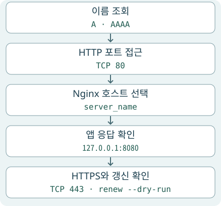

---
{
  "kind": "post",
  "publishedAt": "2026-11-28T04:31:00Z",
  "routeSlug": "2026-11-28-nginx-dns-https",
  "reviewedAt": "2026-11-28",
  "reviewStatus": "source-audited",
  "reviewSources": [
    "https://www.duckdns.org/spec.jsp",
    "https://letsencrypt.org/docs/ipv6-support/",
    "https://nginx.org/en/docs/beginners_guide.html#proxy",
    "https://nginx.org/en/docs/switches.html",
    "https://letsencrypt.org/docs/challenge-types/",
    "https://eff-certbot.readthedocs.io/en/stable/using.html"
  ],
  "reviewScope": "공식 문서와 대조한 절차입니다. 실제 DNS·방화벽·서버 설정 변경, Certbot 실행, 인증서 발급, 외부 서비스 배포 검증은 진행하지 않았습니다.",
  "language": "ko",
  "translationKey": "2026-11-28-nginx-dns-https",
  "title": "AI로 무료 주소와 Nginx 연결하기 · DNS부터 HTTPS까지 확인하는 순서",
  "description": "외부 요청이 앱에 도달하기까지 구간별로 확인하고, 시간 초과와 프록시 오류를 구별한 뒤 인증서와 갱신을 점검합니다.",
  "categories": [
    "tips"
  ],
  "tags": [
    "self-hosting",
    "nginx",
    "dns",
    "https"
  ]
}
---

공인 IPv4가 있는 Linux 서버와 Duck DNS 주소 하나가 있다고 가정합니다. 공개용 앱은 Nginx와 같은 서버의 `127.0.0.1:8080`에서 실행 중입니다. 앞선 메모 앱은 로컬 실습용입니다. 여기서는 외부 공개를 전제로 준비한 별도 앱을 사용합니다.

## AI에게 확인 가능한 절차 요청하기

**프롬프트** 공인 IPv4가 있는 Linux에서 Duck DNS 주소를 Nginx에 연결하려고 해. 앱은 같은 호스트의 `127.0.0.1:8080`에 있어. 실제 주소 대신 `example.com`을 써 줘. DNS A 레코드, 외부 포트 접근, 리버스 프록시, HTTPS 순서로 확인 명령과 예상 결과를 적어 줘. DNS가 정상일 때 시간 초과와 `502`를 어떻게 구별하는지 설명해 줘. 기존 설정을 최소한으로 바꾸고 되돌리는 순서도 알려 줘. 모르는 값은 질문하고 아무것도 실행하지 마.

프롬프트에는 토큰이나 SSH 키를 넣지 마세요. 답변은 연결 구간별로 검토합니다.



## DNS와 로컬 앱 확인하기

이후 `example.com`은 모두 자신의 주소로 바꾸세요. Duck DNS에서 A가 공인 IPv4를 가리키도록 갱신합니다. 외부에서 IPv6로 끝까지 연결할 수 있을 때만 AAAA를 게시하세요. 예시 Nginx는 IPv4에서 수신합니다. dig로 DNS를 조회한 뒤 서버에서 curl을 실행해 평소 앱 응답이 오는지 봅니다. [Duck DNS](https://www.duckdns.org/spec.jsp) · [Let’s Encrypt · IPv6](https://letsencrypt.org/docs/ipv6-support/)

```sh
dig +short example.com A
dig +short example.com AAAA
curl --fail --show-error http://127.0.0.1:8080/
```

## HTTP 요청을 앱으로 전달하기

현재 설정을 보관하세요. 사이트의 http 컨텍스트에 다음 server 블록을 넣고 실제 호스트 이름으로 바꿉니다. `nginx -t`를 통과하면 운영체제의 서비스 관리 방식에 맞춰 설정을 다시 읽힙니다. [NGINX · proxy_pass](https://nginx.org/en/docs/beginners_guide.html#proxy) · [nginx -t](https://nginx.org/en/docs/switches.html)

```nginx
server {
    listen 80;
    server_name example.com;

    location / {
        proxy_pass http://127.0.0.1:8080;
        proxy_set_header Host $host;
        proxy_set_header X-Forwarded-Proto $scheme;
    }
}
```

다른 네트워크에서 HTTP로 접속해 같은 앱 내용이 보이는지 확인합니다. DNS가 맞는데 시간이 초과되면 회선·공유기 포트포워딩·방화벽부터 봅니다. Nginx가 `502`를 반환하면 로컬 앱의 응답과 업스트림 포트부터 봅니다. 되돌릴 때는 보관한 설정을 복원하고 검사한 뒤 다시 읽힙니다.

```sh
curl --fail --show-error http://example.com/
```

## HTTPS 접속과 갱신 모의시험

Certbot Nginx 플러그인을 설치했고 외부에서 TCP `80`번에 접근할 수 있으면 HTTP-01로 이름을 검증할 수 있습니다. 플러그인이 인증서를 설치하고 Nginx 설정을 수정할 수 있으니 작동하는 HTTP 설정을 먼저 보관하세요. 서버에서 Certbot을 실행하고 외부망에서 HTTPS를 확인한 다음 서버에서 갱신을 시험합니다. [Let’s Encrypt · HTTP-01 / DNS-01](https://letsencrypt.org/docs/challenge-types/) · [Certbot](https://eff-certbot.readthedocs.io/en/stable/using.html)

```sh
sudo certbot --nginx -d example.com
```

```sh
curl --fail --show-error https://example.com/
```

```sh
sudo certbot renew --dry-run
```

외부 HTTPS 응답, 인증서의 도메인 이름, 갱신 모의시험 결과를 기록하세요. TCP `80`번이 막혔다면 직접 관리할 수 있는 DNS 영역에서 DNS-01로 소유권을 검증하는 방법도 있습니다. 방문자가 접속하려면 보통 TCP `443`번을 통한 HTTPS 경로가 별도로 필요합니다.

공식 문서와 대조한 절차입니다. 실제 DNS·방화벽·서버 설정 변경, Certbot 실행, 인증서 발급, 외부 서비스 배포 검증은 진행하지 않았습니다.

[로컬 메모 앱 실습](https://youdozi.github.io/ko/posts/2026-11-28-self-hosting-ai-notes/) · [Nginx 셀프호스팅에 쓸 무료 주소 4곳 비교](https://youdozi.github.io/ko/posts/2026-11-28-nginx-free-subdomains/)
