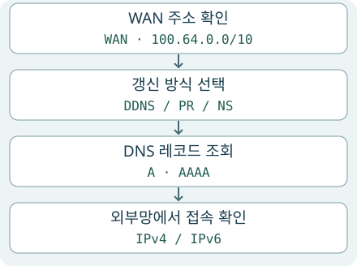

---
{
  "kind": "post",
  "publishedAt": "2026-11-28T04:30:00Z",
  "routeSlug": "2026-11-28-nginx-free-subdomains",
  "reviewedAt": "2026-11-28",
  "reviewStatus": "source-audited",
  "reviewSources": [
    "https://www.duckdns.org/spec.jsp",
    "https://dynv6.com/",
    "https://dynv6.com/docs/apis",
    "https://github.com/is-a-dev/register#-register",
    "https://nic.eu.org/register.html",
    "https://nic.eu.org/top-policy.html",
    "https://www.rfc-editor.org/info/rfc6598/"
  ],
  "reviewScope": "공식 문서를 바탕으로 비교했습니다. 서비스 가입이나 주소 발급은 진행하지 않았습니다.",
  "language": "ko",
  "translationKey": "2026-11-28-nginx-free-subdomains",
  "title": "Nginx 셀프호스팅에 쓸 무료 주소 4곳 비교",
  "description": "집의 IP가 자주 바뀌는지, 개발 포트폴리오에 쓸지, 네임서버를 직접 관리할지에 따라 알맞은 주소가 달라집니다.",
  "categories": [
    "tips"
  ],
  "tags": [
    "self-hosting",
    "nginx",
    "dns"
  ]
}
---

집에서 Nginx를 띄웠다면 방문자에게 어떤 이름을 알려 주면 될까요? 네 서비스 모두 운영자가 관리하는 도메인 아래 무료 서브도메인을 제공합니다. 주소를 받은 뒤 서버 운영과 외부 접속 설정은 직접 맡습니다.

## 집 밖에서 서버에 닿을 수 있나요?

DDNS는 DNS가 돌려주는 IP를 갱신합니다. 요청이 Nginx에 도착하려면 회선·공유기·방화벽이 외부 접속을 허용해야 합니다. 통신사가 CGNAT를 쓰면 집 공유기의 포트포워딩만으로는 연결되지 않을 수 있습니다. 공유기의 WAN 주소가 `100.64.0.0/10` 범위라면 통신사에 공인 IPv4 제공 여부를 확인하세요. [RFC 6598](https://www.rfc-editor.org/info/rfc6598/)

## 주소를 관리할 방식으로 고르기

| 서비스 | 주소 관리 방식 | 어울리는 용도 |
| --- | --- | --- |
| [Duck DNS](https://www.duckdns.org/spec.jsp) | 갱신 도구로 `name.duckdns.org` 주소를 관리합니다. API는 IPv4를 자동 감지할 수 있고 IPv6를 갱신할 때는 주소를 명시합니다. | 공인 IPv4가 바뀌는 집에서 하는 첫 실습. |
| [dynv6](https://dynv6.com/) · [API](https://dynv6.com/docs/apis) | 호스트 이름을 제공하며 API로 A·AAAA 레코드와 IPv6 프리픽스를 갱신할 수 있습니다. | IPv6 또는 듀얼 스택 환경. 기업용 SLA는 제공하지 않습니다. |
| [is-a.dev](https://github.com/is-a-dev/register#-register) | GitHub PR로 신청하면 운영진이 검토합니다. 운영진은 신청서를 직접 작성하라고 안내합니다. | 개발자 포트폴리오. IP가 자주 바뀌면 DDNS가 편합니다. |
| [EU.org](https://nic.eu.org/register.html) · [EU.org NS](https://nic.eu.org/top-policy.html) | 신청 전에 권한 있는 네임서버를 준비합니다. 승인 후 NS 위임을 받으면 자신의 영역에서 A·AAAA를 관리합니다. | DNS 레코드를 직접 운영하려는 경우. 동적 갱신은 별도로 마련합니다. |

## 고른 주소 확인하기



첫 실습이라면 공인 IPv4부터 확인한 뒤 Duck DNS 주소 하나를 연결하세요. dig가 설치된 환경에서 아래 예시 이름을 바꾸고 두 주소 유형을 조회합니다. A가 공인 주소와 일치해야 합니다. AAAA를 게시했다면 외부망에서 IPv6로도 접속해 보세요.

```sh
dig +short name.duckdns.org A
dig +short name.duckdns.org AAAA
```

공식 문서를 바탕으로 비교했습니다. 서비스 가입이나 주소 발급은 진행하지 않았습니다.

[로컬 메모 앱 실습](https://youdozi.github.io/ko/posts/2026-11-28-self-hosting-ai-notes/) · [AI로 무료 주소와 Nginx 연결하기 · DNS부터 HTTPS까지 확인하는 순서](https://youdozi.github.io/ko/posts/2026-11-28-nginx-dns-https/)
