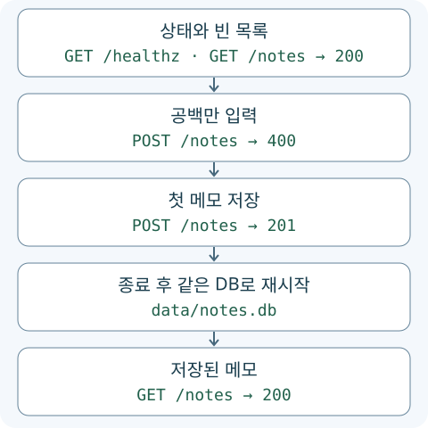

---
{
  "kind": "post",
  "publishedAt": "2026-11-28T02:37:00Z",
  "routeSlug": "2026-11-28-self-hosting-ai-notes",
  "language": "ko",
  "translationKey": "2026-11-28-self-hosting-ai-notes",
  "title": "AI로 만든 앱, 내 서버에서 운영하려면 · 메모 앱으로 시작하는 셀프호스팅",
  "description": "AI에게 메모 API를 요청하고, 프로세스를 종료한 뒤에도 같은 SQLite 파일에서 첫 메모를 읽을 수 있는지 확인합니다.",
  "categories": [
    "tips"
  ],
  "tags": [
    "self-hosting",
    "python",
    "sqlite"
  ]
}
---

AI가 만들어 준 메모 앱에서 첫 메모가 저장됐습니다. 이제 앱을 끄고 다시 켜 봅니다. 메모가 그대로 있나요? 셀프호스팅에서 처음 확인할 것은 화면이 뜨는지와 함께, 프로그램을 재시작해도 데이터가 남는지입니다. 이 글에서는 AI에게 작은 메모 앱과 실행 절차를 맡기고 결과를 내 컴퓨터에서 확인합니다. 예제는 Python과 SQLite만 사용합니다.

## AI에게 기능과 운영 조건을 함께 주기

“메모 앱을 만들어 줘”라고 하면 저장 방식이나 접속 범위는 모델이 결정할 수 있습니다. 처음부터 데이터를 어디에 보관할지, 누가 접속할 수 있어야 하는지, 무엇을 확인하면 완료인지 정합니다.

> Python 표준 라이브러리와 SQLite로 개인용 메모 API를 만들어줘. 앱은 `127.0.0.1`에서만 실행하고, 메모는 `data/notes.db`에 저장해. `GET /healthz`는 상태를 반환하고, `GET /notes`은 목록을 보여줘. `POST /notes`는 `{"text":"첫 메모"}` 형식을 받고, 공백뿐인 입력은 `400`으로 거절해. `app.py`와 실행·종료 명령, curl 확인 예시를 작성해줘. 검증 순서는 상태 확인 → 메모 저장 → 프로세스 종료 → 같은 DB로 재시작 → 메모 조회야. 열리는 주소와 생성되는 파일을 명시해줘.

## 실행 전에 주소와 저장 경로를 검토하기

서버가 `127.0.0.1`에 바인딩되고 SQLite가 디스크의 `data/notes.db`를 여는지 확인하세요. 상대 경로만 주면 실행 위치가 바뀔 때 다른 DB가 열릴 수 있습니다. 아래 예제는 앱 파일을 기준으로 경로를 정합니다. Python의 `http.server`는 여기서 로컬 학습용으로 사용합니다. [http.server](https://docs.python.org/3/library/http.server.html) · [sqlite3](https://docs.python.org/3/library/sqlite3.html)

빈 실습 디렉터리에 다음 코드를 `app.py`로 저장하세요.

```python
import json
import sqlite3
from http.server import BaseHTTPRequestHandler, HTTPServer
from pathlib import Path

db_path = Path(__file__).resolve().parent / "data" / "notes.db"


class Notes(BaseHTTPRequestHandler):
    def reply(self, status, value):
        body = json.dumps(value, ensure_ascii=False).encode("utf-8")
        self.send_response(status)
        self.send_header("Content-Type", "application/json; charset=utf-8")
        self.send_header("Content-Length", str(len(body)))
        self.end_headers()
        self.wfile.write(body)

    def do_GET(self):
        if self.path == "/healthz":
            self.reply(200, {"status": "ok"})
        elif self.path == "/notes":
            rows = db.execute("SELECT text FROM notes ORDER BY id")
            self.reply(200, [{"text": text} for (text,) in rows])
        else:
            self.reply(404, {"error": "unknown path"})

    def do_POST(self):
        if self.path != "/notes":
            self.reply(404, {"error": "unknown path"})
            return
        try:
            size = int(self.headers.get("Content-Length", "0"))
            if not 0 < size <= 8192:
                raise ValueError
            data = json.loads(self.rfile.read(size))
            if not isinstance(data, dict):
                raise ValueError
            text = data.get("text")
            if not isinstance(text, str) or not text.strip():
                raise ValueError
        except ValueError:
            self.reply(400, {"error": "invalid note"})
            return
        with db:
            db.execute("INSERT INTO notes (text) VALUES (?)", (text,))
        self.reply(201, {"text": text})


if __name__ == "__main__":
    db_path.parent.mkdir(exist_ok=True)
    db = sqlite3.connect(db_path)
    try:
        db.execute("CREATE TABLE IF NOT EXISTS notes (id INTEGER PRIMARY KEY, text TEXT NOT NULL)")
        with HTTPServer(("127.0.0.1", 0), Notes) as server:
            print(f"http://127.0.0.1:{server.server_port}", db_path, sep="\n", flush=True)
            server.serve_forever()
    except KeyboardInterrupt:
        pass
    finally:
        db.close()
```

## AI의 설명을 실제 요청으로 검증하기



메모가 디스크에 남았는지 확인하려면 저장한 프로세스를 종료한 뒤 새 프로세스에서 읽어야 합니다.

앱 디렉터리에서 `python3 app.py`을 실행하세요. 첫 줄은 임시 포트가 포함된 주소, 다음 줄은 DB 경로입니다. 다른 터미널에서 아래 명령을 실행하고 `read`가 기다리면 첫 줄의 주소를 붙여 넣으세요.

```sh
read -r base
```

```sh
curl -i "$base/healthz"
curl -i "$base/notes"
curl -i -H 'Content-Type: application/json' -d '{"text":"   "}' "$base/notes"
curl -i -H 'Content-Type: application/json' -d '{"text":"첫 메모"}' "$base/notes"
```

앱 터미널에서 `Ctrl+C`를 눌러 셸 프롬프트가 돌아오는지 확인한 뒤 `python3 app.py`을 다시 실행하세요. DB 경로가 같은지 보고 두 번째 터미널에 새 주소를 입력하세요.

```sh
read -r base
```

```sh
curl -i "$base/notes"
```

Python `3.13.0`의 임시 로컬 환경에서 루프백과 임시 포트로 확인했습니다. 상태 조회와 초기 빈 목록은 `200`, 공백만 보낸 요청은 `400`, 첫 메모 저장은 `201`였습니다. 프로세스 종료를 확인하고 같은 DB로 재시작하자 목록 요청이 `200`와 기존 메모를 반환했습니다. 목록이 비어 보이면 두 번의 실제 DB 경로를 비교하세요. AI에게는 실행 명령과 DB 경로, HTTP 응답을 함께 보여 주세요.

## 계속 쓸 앱이라면 백업과 복원까지 준비하기

“이 컴퓨터가 고장 나면 다른 곳에서 메모를 열 수 있나?” AI에게 데이터 경로를 알려 달라고 하고 백업을 새 디렉터리에 복원해 메모를 조회하는 절차를 요청하세요. 실제 서버로 옮길 때는 재부팅 후 앱을 시작하는 방법과 접근 권한도 확인하세요. 이번 실습은 로컬 요청, 저장, 재시작 후 조회까지입니다. 외부 접속과 백업 복원은 시험하지 않았습니다. [맥북을 사설 네트워크의 개인 서버로 사용하기](https://youdozi.github.io/ko/posts/2026-11-23-macbook-personal-server/)
